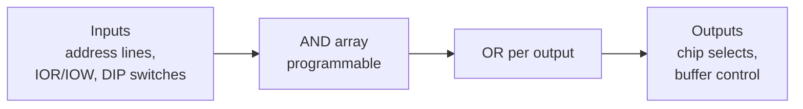
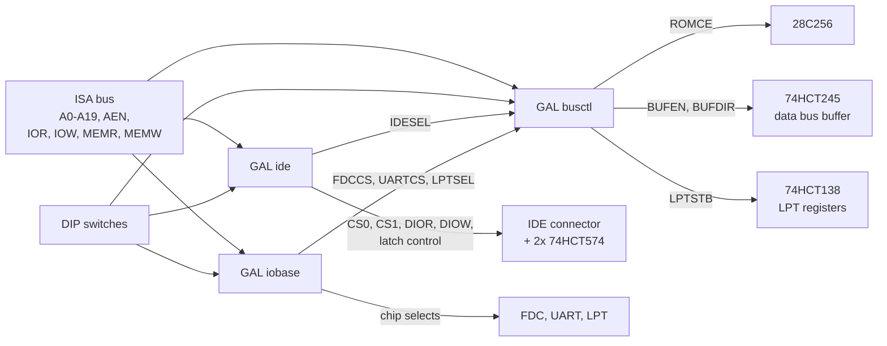

# How the GALs work

The card needs a lot of small glue logic: "is this I/O address mine?", "which chip is meant?", "which way does the data bus buffer drive?". On classic cards this is done with comparators (74688) and decoders (74138). Here three ATF22V10C GALs do that job.

## What a GAL is

A GAL (Generic Array Logic) is a small programmable logic chip. Inside there is an AND array followed by OR gates: every output is a **sum of products** – one or more AND terms, ORed together.



The `.pld` files in [`../gal`](../gal) describe these terms as text. GALasm turns them into a `.jed` fuse map; the programmer (XGecu T48) burns it into the chip. The chip can be erased and reprogrammed, so a wrong equation costs a reprogram, not a new board.

## Anatomy of a `.pld` file

Example: [`../gal/iobase.pld`](../gal/iobase.pld), shortened.

```
GAL22V10                                                   (1) chip type
IOBASE                                                     (2) signature, max. 8 characters

A2    A3    A4    A5    A6    A7    A8    A9    AEN   FDCEN FS    GND     (3) pins 1-12
UARTEN US0  US1   LS0   LS1   NC1   NC2   NC3   FDCCS UARTCS LPTSEL VCC   (4) pins 13-24

/FDCCS  = A9 * A8 * A7 * A6 * A5 * A4 * /A3 * /AEN * FDCEN * /FS          (5) equations
        + A9 * A8 * /A7 * A6 * A5 * A4 * /A3 * /AEN * FDCEN * FS

DESCRIPTION                                                (6) free text, ignored
```

1. **Chip type**: `GAL22V10` (fits ATF22V10C).
2. **Signature**: a name stored in the chip, handy to tell the three GALs apart.
3. and 4. **Pin list**: 24 names in pin order, 12 per line, exactly as on the DIP-24 package. Pin 12 must be `GND`, pin 24 `VCC`. `NC` marks an unused pin. The name is all GALasm knows about a pin – whether it is an input or an output follows from whether an equation assigns it.
5. **Equations**: one per output pin. A line starting with `+` continues the previous equation (another OR term). Each output may only be assigned once.
6. **DESCRIPTION**: everything after this keyword is a comment.

`galasm iobase.pld` writes four files: `.jed` (fuse map for the programmer – the only file you need), `.pin` (pin list as GALasm understood it), `.chp` (pinout drawing) and `.fus` (fuse map in readable form). If something is wrong (unknown name, too many terms on a pin), GALasm stops with the line number.

## Reading an equation

```
/FDCCS = A9 * A8 * A7 * A6 * A5 * A4 * /A3 * /AEN * FDCEN * /FS
       + ...
```

- `*` = AND, `+` = OR, `/` = signal is low (inverted).
- `/FDCCS` on the left: the output pin goes **low** when the right side is true (the ISA chip selects are active low).
- This line reads: address bits 9–4 are all 1, A3 is 0, AEN is 0 (no DMA cycle), the floppy block is switched on and the FS switch selects the primary address. That is exactly the range **3F0h–3F7h**.

Every term can only AND the inputs together, and a 22V10 output has room for 8 to 16 terms, depending on the pin. That limit is why the logic is split into three chips.

## The three GALs



| GAL | Job | Outputs |
|---|---|---|
| `ide` | XT-IDE register map at 300h or 320h | IDE chip selects CS0/CS1, read/write strobes DIOR/DIOW, high-byte latch control HWR/HRDOE, IDESEL |
| `iobase` | Base addresses of the other I/O blocks | FDC 3F0h/370h, UART COM1–COM4, LPT 378h/278h/3BCh or off |
| `busctl` | Memory and bus control | ROM select (C8000h/D0000h/D8000h/E0000h), data bus buffer enable and direction, LPT strobe |

### `ide` – XT-IDE register map

An IDE drive has a 16-bit data register, but the 8-bit ISA bus only carries 8 bits. The XT-IDE trick: the low byte goes directly to the drive, the high byte goes through a latch at base+8.

- **Read:** the CPU reads base+0. The drive delivers 16 bits; the low byte goes to the CPU, the high byte is caught in a 74HCT574 (clocked by DIOR). Then the CPU reads base+8 and gets the high byte from that latch (HRDOE).
- **Write:** the CPU first writes the high byte to base+8 (HWR clocks it into the second 574), then the low byte to base+0. DIOW then puts both halves on the drive at once.
- base+E/F are the drive's CS1 registers (alternate status, device control).

The high-speed jumpers swap A0 and A3 in front of the GAL, so data and latch sit at base+0 and base+1. The 8088 can then read both bytes with a single word instruction. The equations stay the same.

### `iobase` – where the other blocks live

Only address decoding: the GAL compares A2–A9 with the DIP switch setting and pulls the chip select of the FDC, UART or parallel port low. IOR/IOW go to those chips directly. Every term contains `/AEN`, so DMA cycles never select anything.

### `busctl` – ROM and data bus

- **ROMCE** selects the 28C256 in a 32 KiB window chosen with RS0/RS1.
- **BUFEN** opens the 74HCT245 only when a cycle belongs to this card: an I/O access to one of its blocks, an FDC DMA cycle (DACK) or a ROM access. Otherwise the card stays off the ISA data bus, so it cannot collide with other cards.
- **BUFDIR** sets the direction: low during read cycles (card → ISA), high during writes.
- **LPTSTB** enables the 74HCT138, which splits the parallel port's four registers by A0, A1 and read/write.

## Check before burning

[`../tests/check_gal.py`](../tests/check_gal.py) reads the equations and steps through every relevant address. It checks that each block answers in exactly its range, that nothing answers during DMA (AEN), and that the buffer only drives on this card's own read cycles. How to build and burn: [gal-programming.md](gal-programming.md).

Status: the equations pass this check; the GALs have not been tested in hardware yet.
